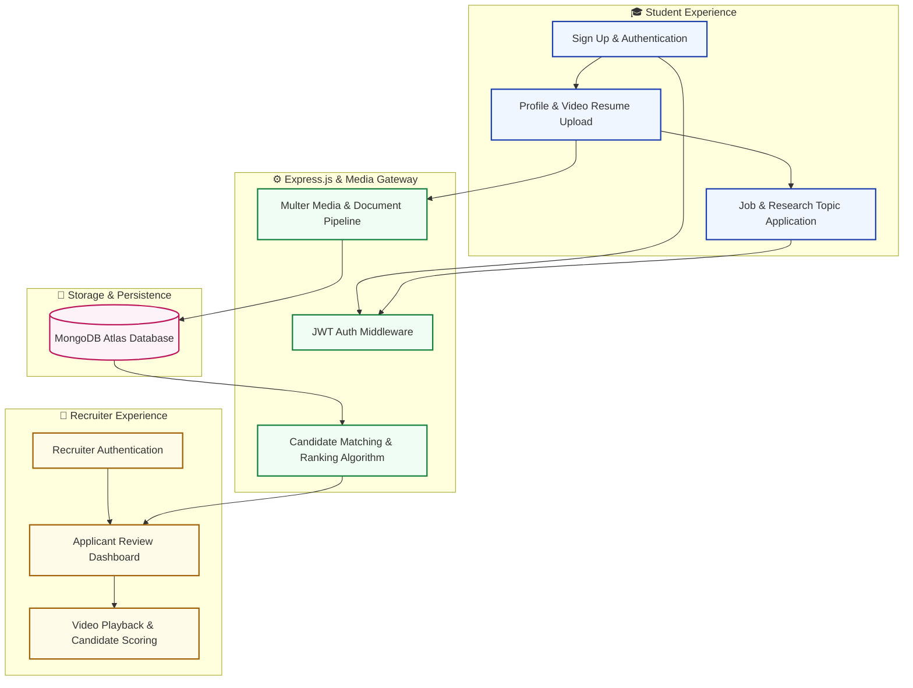

# Student & Recruiter Talent Match Platform

<div align="center">

[](frontend/)
[](backend/)
[]()
[]()

**A dual-sided web platform enabling student video resumes, skill profiling, and recruiter candidate ranking.**

</div>

---

## 📌 System Overview

This application bridges student researchers and academic/industry recruiters. Students submit structured application packages containing video resumes, cover letters, and transcripts, while recruiters evaluate candidates using automated skill-match scoring and ranking tools.

---

## 🔄 Dual-Portal Workflow & Architecture



---

## 🚀 Setup & Local Execution

### Prerequisites
- Node.js (v18+)
- MongoDB Atlas account (or local MongoDB instance)

### Backend Configuration
```bash
cd backend
npm install

# Create .env file
# MONGODB_URI=your_mongodb_uri
# JWT_SECRET=your_jwt_secret
# PORT=5001

npm start
```

### Frontend Configuration
```bash
cd ../frontend
npm install
npm start
```

The frontend will run at `http://localhost:3000` and communicate with the backend at `http://localhost:5001`.

---

## 📬 Contact

- **Author**: Sayan Bhattacharya
- **Email**: [sayanpm17@gmail.com](mailto:sayanpm17@gmail.com)
- **LinkedIn**: [linkedin.com/in/snbhattacharya5](https://www.linkedin.com/in/snbhattacharya5/)
